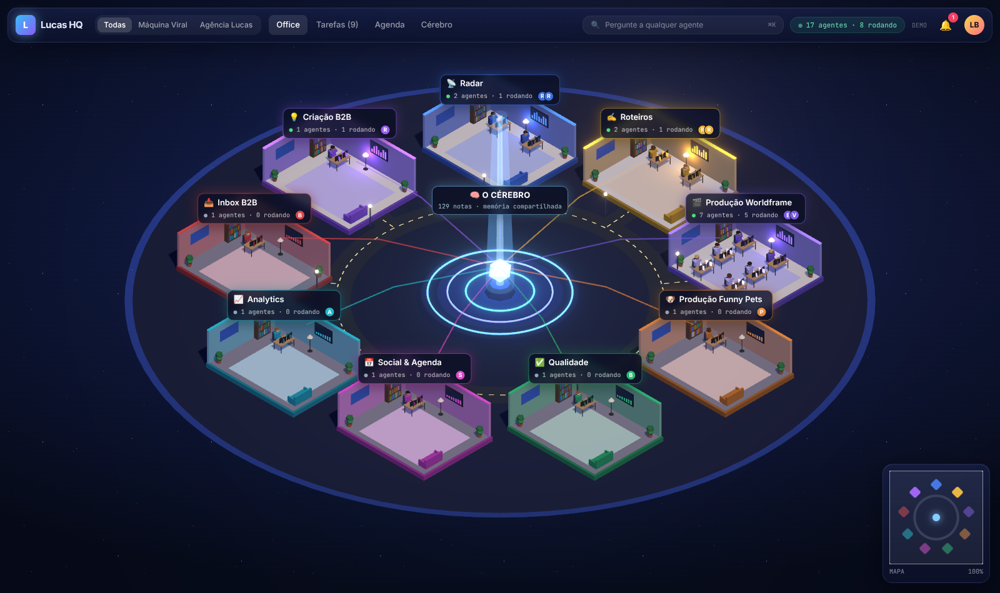

# Lucas HQ

Escritório de agentes de IA em 3D isométrico. Os times reais são subagentes do Claude Code (`.claude/agents/`), com ferramentas determinísticas (`tools/`), cérebro compartilhado (MCP memory → `brain/memory.jsonl`) e aprovação humana. A interface (`apps/office`) mostra tudo ao vivo via Supabase Realtime.



## Rodar
```bash
pnpm install
```
```bash
pnpm dev
```
Abra `http://localhost:5173/?demo=1` para o modo demo (eventos simulados). Sem Supabase configurado, a interface roda com o seed local.

## Supabase
1. Crie o projeto e rode `supabase/migrations/0001_lucas_hq.sql` e depois `supabase/seed.sql` no SQL editor.
2. Front: copie `apps/office/.env.example` para `apps/office/.env.local` com `VITE_SUPABASE_URL` e `VITE_SUPABASE_ANON_KEY`.
3. Agentes: exporte `SUPABASE_URL` e `SUPABASE_SERVICE_KEY` no terminal do Claude Code.

## Agentes
`pip install -r tools/requirements.txt` (precisa de `ffmpeg`). Comandos: `/rodar-worldframe [teste]`, `/alimentar-acervo`, `/briefing-cliente <texto>`, `/status`.

## Deploy
- **Vercel**: importe o repo; o `vercel.json` já define build e saída. Configure as duas variáveis `VITE_*`.
- **GitHub Pages**: `.github/workflows/pages.yml` (secrets `VITE_SUPABASE_URL`, `VITE_SUPABASE_ANON_KEY`; Pages → Source: GitHub Actions).

## Checklist final
- [x] Cena 3D: cérebro, 9 salas, móveis, estradas, câmera isométrica, top bar, mini-mapa
- [x] Animações: digitando/andando, partículas de memória, bloom, ocioso/rodando, `?demo=1`
- [x] Painel do time, Tarefas, Agenda e Cérebro ligados ao Supabase Realtime (com fallback local)
- [x] 12 agentes, 4 comandos, 7 ferramentas, cérebro MCP, permissões (`rm` negado, geração no Higgsfield e `mv` para `done/` pedem OK)
- [x] Teste de 1 vídeo: corte → vertical → legendas → capa → frames → Drive (dry-run) → agenda
- [ ] Você: criar projeto Supabase e colar as chaves
- [ ] Você: cliente OAuth do Drive em `~/.config/lucas-hq/oauth-client.json` + `python3 tools/drive_upload.py --login`, e login no Higgsfield MCP
- [ ] Você: conectar o repo na Vercel (ou ativar Pages)
